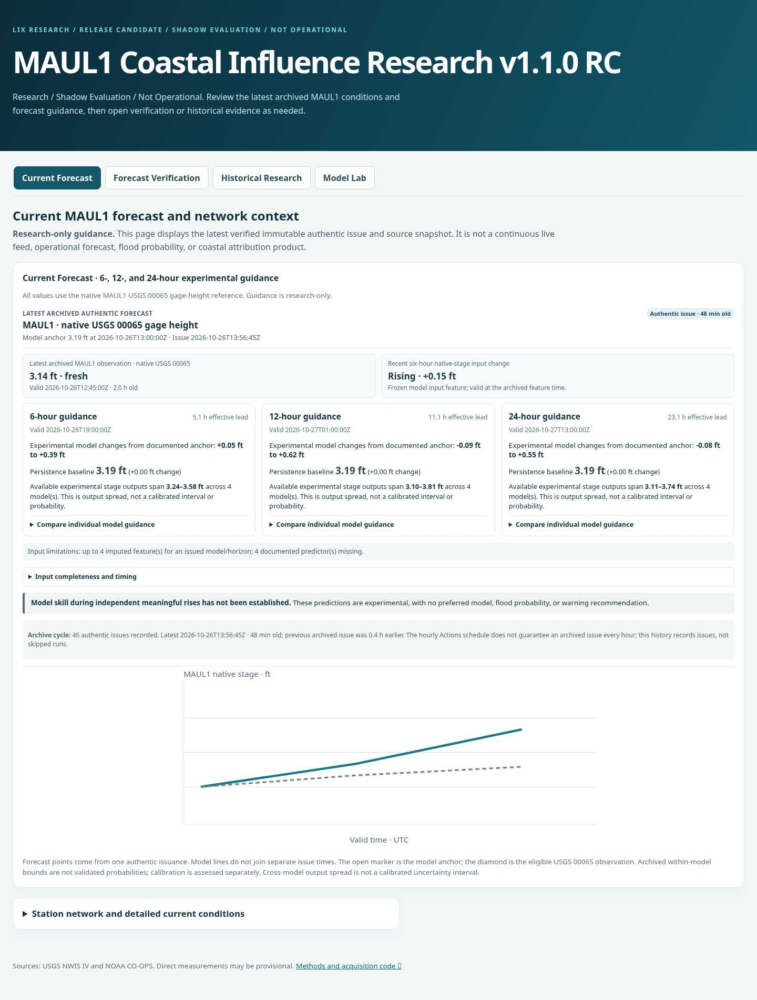
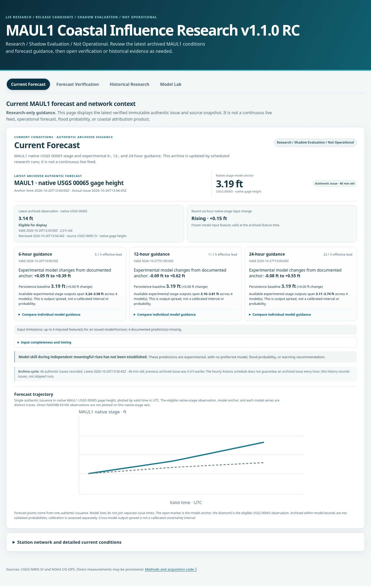
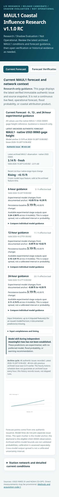
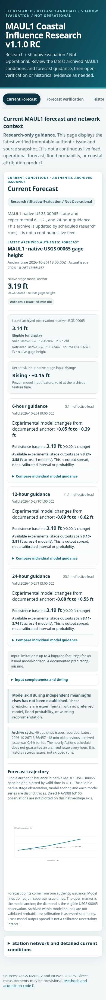

# Phase 6.18 · Research dashboard UI redesign

The Current Forecast page now leads with an unmistakably research-only label and a compact evidence hierarchy: the authentic issue’s native 00065 model anchor, issue age, latest archived eligible native-stage observation with valid/retrieval times and observation age, the recorded six-hour native-stage feature change when available, then the three experimental horizons. Each horizon retains its existing model names, values, effective lead, output spread caveat, and progressive model detail table.

The trajectory chart remains one authentic issuance, using the existing traces and native-stage eligibility rules. Its axis names explicitly identify UTC and native MAUL1 gage height. Direct NAVD88 63160 observations are not combined with 00065 or model output. When Plotly is available the chart now exposes hover, zoom, pan, reset, and responsive sizing controls. The four app views, archive data, links, tab hashes, and keyboard navigation remain in place.

## Shared visual tokens

`site/style.css` now defines reusable `--color-*`, `--space-*`, `--radius-*`, `--shadow-card`, `--content-width`, and `--focus-ring` tokens. Shared patterns cover cards, tabs, focus states, tables, status labels, typography, spacing, and breakpoints. Status pills use neutral text and color so they describe freshness or availability without implying a warning level. Agent 2 can adopt these tokens and components in a later UI follow-up.

## Screenshots

The before/after captures use the same authentic archive snapshot from the initial dashboard checkout at `57e4517`; no observation or forecast values were edited for the screenshots. The PR itself is based on newer `main` commit `4eb0d42`, which contains a later prospective archive cycle. Desktop viewport is 1440×1000; mobile viewport is 390×844. Full-page images show the entire visible Current Forecast panel.

| View | Before | After |
|---|---|---|
| Desktop |  |  |
| Mobile |  |  |

The environment blocks the Plotly CDN, so the screenshot run injected the same local SVG chart stand-in before both page versions. It is not a substitute for Plotly and is used only to compare surrounding responsive layout. A browser run of the real page showed the existing chart-unavailable fallback when the CDN could not load. The committed page retains Plotly 2.35.2 from its existing CDN and its actual interactive `Plotly.react` path is covered by a Node integration smoke test with captured traces, layout, and config.

## Scientific and availability behavior

- Stage values and forecast traces are not recalculated or transformed in this redesign.
- Stale observations remain visible with their archived valid and retrieval times, but are withheld from the chart under the existing freshness rule.
- Missing or ineligible observations remain explicit. Predictor freshness, missingness, feature timing, and imputation details remain available under the existing timing/completeness disclosure.
- The expanded model table now renders the archived model status (`withheld`, `abstained`, or another recorded status) in place of the previous generic “Unavailable for this issue” label.
- No verification calculations, hindcasts, authentic issuance files, verification revisions, model artifacts, or source data were changed.

## Browser and test evidence

Chromium loaded the current archived page at 1440px and 390px with no horizontal overflow. The screenshot stand-in rendered within the existing forecast chart container. Automated UI regression checks cover exact stage values, model and observation trace values, datum separation, observation freshness/missingness, status labels, responsive CSS contracts, accessible chart labelling, and the Plotly interaction configuration. Real deployed Plotly rendering remains subject to the existing CDN being reachable in the viewer’s browser.
