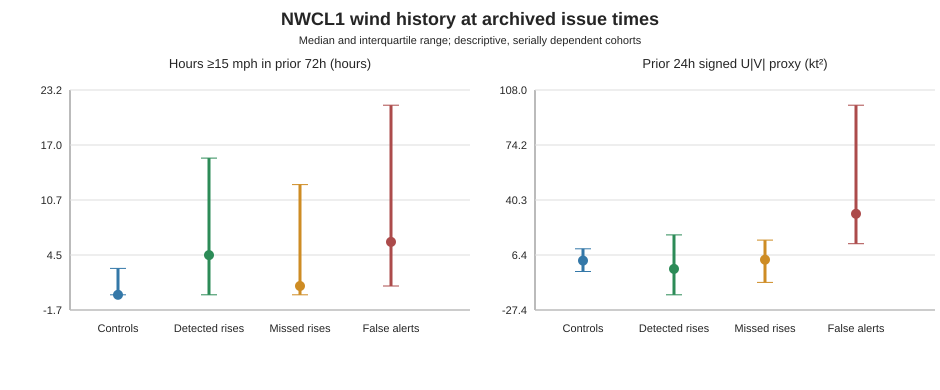

# Directional wind forcing, duration, and hydrologic memory

**Status: Research / Shadow Evaluation / Not Operational**  
**Conclusion: inconclusive; physically plausible, not demonstrated as incremental predictive information.**

## Executive findings

1. Wind is not absent from the frozen model. Phase 5A and Phase 6 use NWCL1 current east/north vector components, 6-hour and 24-hour vector means, and 6-hour directional persistence. Phase 5B coastal-tidal/full retain those fields. They also use clock harmonics as calendar proxies, not an observed/predicted local tide model.
2. Features still absent from the models include cumulative wind stress/impulse, 3/12/48/72-hour wind summaries, persistent-direction run length, threshold duration, wind relaxation/reversal memory, lagged wind-by-water-level/river interactions, and a distributed-lag or decay-memory term. The archive includes some non-model diagnostic windows, but these do not enter the frozen model.
3. NWCL1 retrospective descriptors showed broad overlap across detected rises, missed rises, and nonresponse controls. False-alert clusters also often had strong and persistent wind descriptors. The current small descriptive analysis does not distinguish whether prolonged wind improves rise prediction or adds false alarms.
4. Alberto’s archived window includes a strong lake/MAUL1 rise, but does not support the supplied exploratory statement of six consecutive days above 15 mph at NWCL1. Alberto’s period-wide maximum hourly vector speed was 27.90 mph, with 26 of 384 hours above 15 mph. This does not adjudicate a separate WeatherFlow sensor’s record.
5. Alberto and Beryl had markedly different NWCL1 wind magnitudes and both had coastal/MAUL1 responses. Each event also had important competing hydrologic context. Neither storm-name comparison establishes a wind mechanism or response delay.
6. No prospective skill, independent out-of-sample improvement, physical propagation time, or causal wind attribution has been established. Do not promote a wind-memory challenger based on this analysis.

## Existing-model feature audit

The inventory below was checked against `scripts/phase5a.py`, `scripts/phase5b.py`, frozen `site/data/prospective/model-artifacts.json`, and the committed forecast feature definitions.

| Family | Already represented | Missing or under-validated |
|---|---|---|
| Wind magnitude and direction | NWCL1 current `wind_u`, `wind_v` in knots; these encode speed and direction. Current vector magnitude is derivable. | No other wind station in the frozen predictors. NWCL1 representativeness of lake-wide or open-water field is not validated. |
| Wind lags/averages | 6-hour and 24-hour mean U/V, based on completed hourly bins with at least 80% coverage. | 3-, 12-, 48-, and 72-hour summaries are not model inputs. Historical availability is valid-time only, without receipt timestamps. |
| Direction persistence | Six-hour vector resultant length, requiring at least five valid hourly vectors. | Longer persistence, run duration, directional reversal, and fetch-projected components are absent. The local archive does include additional exploratory vector means, not frozen model inputs. |
| Wind stress/cumulative forcing | None. | No U·speed/V·speed stress proxy, integrated directional forcing, nonlinear duration × intensity term, or calibrated physical stress. No wind-height/exposure history is retained for normalization. |
| Hydrologic memory | MAUL1 native stage and recent changes (1/3/6/12/24/72h as model family permits), six-hour slope and 24-hour variability; NWCL1 MLLW residual and changes; MDLL1 stage changes; DENL1 discharge and changes. | No explicit wind-to-stage distributed lag, wind-relaxation memory, lake-level anomaly interaction with accumulated wind, or calibrated response kernel. MCHL1 remains untrusted/shadow-only. |
| Other periodic terms | Phase 5B uses 24h, 12.42h, and 14.765d clock harmonics. | These are time/calendar harmonics, not observed astronomical tide predictions or a synoptic pressure field. |

Phase 5A archives include extra exploratory 3/6/12/24-hour vectors; presence in an archive must not be mistaken for model use. Frozen Phase 6 was not changed or retrained.

## Fixed issue-time descriptor analysis

The script computes windows of 3, 6, 12, 24, 48, and 72 completed hours before each chosen issue time. It applies an 80% nonmissing rule for continuous summaries, never interpolates, and missing bins break directional runs. The issued hour is excluded. A count above 10, 15, or 20 mph is a sensitivity descriptor using archived hourly mean vector speed—not a proposed trigger. Since local lake fetch/orientation and sensor geometry were not validated, signed `-U` is reported as the westward component only; no direction is labeled “favorable”. `-U × speed` is a proxy in kt², not physical stress. Physical stress would require defensible sensor height/exposure and drag treatment.

The fixed cohort sample contains 28 detected Phase 6 rise groups, 81 missed groups, 48 false-alert clusters, and 63 eligible Phase 3B nonresponse control candidates. It is one descriptor time per group/cluster/control. The Phase 6 groups are target-defined, not verified physical storms; control candidates are not event-matched independent observations. Cohorts are serially dependent and can overlap in time. Quartiles below are descriptive, with no p-values or independence assumption.

| Descriptor at selected issue time | Detected rises (n=28) | Missed rises (n=81) | False-alert clusters (n=48) | Eligible controls (n=63) |
|---|---:|---:|---:|---:|
| Median hours with NWCL1 speed ≥15 mph in prior 72h (Q1–Q3) | 4.5 (0–15.5) | 1 (0–12.5) | 6 (1–21.5) | 0 (0–3) |
| Median westward impulse proxy, prior 72h, kt·h (Q1–Q3) | 32.1 (−106.7–170.2) | 14.0 (−115.9–164.0) | 117.4 (−27.4–266.1) | 99.5 (−16.5–176.2) |
| Median signed `-U × speed` proxy, prior 24h, kt² (Q1–Q3) | −2.2 (−18.1–18.8) | 3.5 (−10.4–15.6) | 31.8 (13.4–98.7) | 3.0 (−3.7–10.2) |
| Median 24h directional persistence (Q1–Q3) | 0.72 (0.54–0.94) | 0.84 (0.56–0.95) | 0.85 (0.58–0.96) | 0.76 (0.47–0.91) |

`15 mph` is shown only because it appeared in the exploratory hypothesis; it is not validated as an onset threshold. False alerts can have substantial wind forcing, and missed rises span both weak and sustained forcing descriptors. A static issue-time cohort comparison cannot establish incremental forecast value, latency, causal direction, or whether adding features would help detection without raising false alarms.

## Alberto, Beryl, May 2021, and Isaac

The archived core series starts in 2016, so it can reconstruct Alberto (2024), Beryl (2024), and May 2021, but **not Isaac (2012)**. The user’s “Alberto effects.pptx” Google Slides URL returned a Drive/Slides 404 in this session. I could not inspect its slide charts, annotations, original WeatherFlow station metadata, or event-specific duration calculations. The calculations below use the committed hourly NWCL1/core water-stage archive and Phase 3B event catalog, not the unavailable presentation or raw WeatherFlow observations.

| Period | NWCL1 wind and coastal/river context | Archived water response (native station records) |
|---|---|---|
| Alberto window, 2024-06-12 to 2024-06-28 UTC | 26/384 hourly vector speeds >15 mph; maximum 27.90 mph. Therefore no support here for a six-day >15 mph run at NWCL1. | NWCL1 water rose by at most 1.251 ft/24h (MLLW) on Jun 19; its predicted tide rose at most 0.078 ft/24h. MDLL1 native stage max 24h rise 1.335 ft. MAUL1 00065 native gage height max 24h rise 0.725 ft, reaching 4.45 ft Jun 21 04Z. DENL1 discharge increased 212 cfs/24h to 814 cfs Jun 17. |
| Beryl window, 2024-06-27 to 2024-07-20 UTC | 1/552 hourly vector speeds >15 mph; maximum 15.23 mph at NWCL1. | NWCL1 water max 24h rise 0.705 ft Jun 29; MDLL1 native stage 0.68 ft/24h; MAUL1 native stage 0.735 ft/24h Jun 30. DENL1 discharge later increased 595 cfs/24h to 1,102.5 cfs Jul 5. MAUL1 response continued through Jul 9. |
| May 2021 | 48/744 hourly vector speeds >15 mph; maximum 21.36 mph. | NWCL1 water rose up to 1.177 ft/24h May 20, MDLL1 up to 1.295 ft/24h, MAUL1 native stage up to 1.07 ft/24h. DENL1 reached 31,600 cfs; maximum 24h change was 13,100 cfs May 19. Large local-river forcing is a major competing explanation. |
| Isaac, 2012 | Outside the committed hourly archive. | No reconstruction or delay estimate made. Historical station data would need to be retrieved and QC/datum-audited before analysis. |

Phase 3B event catalog entries are not physical-onset labels. Its Alberto-associated MAUL1 response window begins Jun 10 01Z and peaks Jun 21 04Z (+2.2 ft); Beryl-period response begins Jun 28 08Z and peaks Jul 9 06Z (+1.475 ft); May 2021 response begins May 8 16Z and peaks May 22 02Z (+4.38 ft). These broad response windows and the selected weather-period windows are not directly equivalent. The discrepancies make subjective onset and “delay” estimates sensitive to definition. We did not calculate an objective 12–36h or mean 17.4h physical response delay because no predeclared forcing onset, clean independent forcing series, or validated propagation event matching was available.

NHC/WPC reports describe different storm-scale synoptic situations, but no numerical pressure-gradient analysis was completed. NOAA NARR is a defensible public source for retrospective, 3-hourly, ~32-km synoptic context (not in-lake wind and not an issue-time operational input); the external data endpoint was unavailable from this session. Thus Alberto-versus-Beryl comparison is limited to the archived local observations and official storm context. A cyclone name, category, or track distance is not used as a forcing proxy.

## Failure and false-alert interpretation

The existing rise-failure audit reproduces 109 grouped rises: 28 detected, 81 missed; 79 missed groups never reached the required forecast-rise threshold on a qualifying target, and two crossed only after their first qualifying target. There are 48 false-alert clusters (305 overlapping false-positive target windows). These are not 109 independent physical events.

At selected first issue times, median 72-hour >15 mph hours are 1 for missed groups, 4.5 for detected groups, and 6 for false alerts. This does not suggest a clean missed-rise wind-memory signature; strong winds also occur in false alerts. The false alert catalog’s archived median instantaneous wind speed is 15.78 kt for false clusters and 16.17 kt for hit-containing clusters, likewise a weak separator. Missed events span 57 large subthreshold predictions and 22 near-threshold underforecasts; without rainfall archive and without a matched design, forcing attribution is unresolved. DENL1 and MDLL1 context already appears in the existing model/audit. A wind-by-river interaction remains a hypothesis only.

No model was fitted, retuned, rescored, or compared for forecast skill. Repeated search against 2023+ would reuse the historical evaluation period and cannot serve as independent validation. Any challenger requires a pre-registered small feature set and chronological/event-blocked evaluation with purging, paired errors, event-level uncertainty and prospective archival proof.

## Spatial propagation, pressure, and datum safeguards

This committed archive does not contain a validated hourly record for PLAL1, LRLL1, RGTL1/RFPL1, West End/WEGL1, WeatherFlow XPTN, or a confirmed DNAL1 sensor identity. The station inventory in PR #58 is not a historical time series. No station-to-station absolute gradient or propagation sequence was calculated here.

Within-station changes and NWCL1 water-minus-prediction residual remain in their own datum. MAUL1 USGS parameter 00065 is native gage height; it is not NAVD88 parameter 63160. MDLL1 and MCHL1 native values are not subtracted from MAUL1 or NWCL1. MCHL1 remains shadow-only due unresolved sensor/datum lineage. NOAA predictions are retrospective valid-time records, not proven issue-time data availability. Spatial precursor claims must wait for audited timestamps, instrument metadata, datum history, and independent sensor identity.

## Recommendation

- **Historical acquisition:** Yes, focused on raw hourly NOAA/USGS/CO-OPS station observations and metadata around the selected events; prioritize verifiable wind height/exposure, station identity, sensor transitions, and timestamps. Recover the user’s presentation and the original WeatherFlow XPTN record if available. Retrieve pressure/wind reanalysis for synoptic context, but do not treat it as local lake wind.
- **Prospective archival:** Yes. Preserve timestamped NWCL1 raw vectors, an independent over-water wind series if a freely accessible and stable feed can be verified, the same-datum NWCL1 water/prediction series, MDLL1 and DENL1, and per-observation provider receipt/QC/provisional fields. Archive actual station metadata versions and uptime. This is useful before deciding whether stations or features earn model inclusion.
- **Focused challenger:** Not yet. A later challenger may test a small predeclared set (e.g. 12/24/48/72h directional vector/stress proxy and relaxation terms) against the existing feature set, with fixed thresholds/windows, blocked development and an untouched future prospective period. Do not use tuning over reused 2023+ to claim independent improvement.
- **Physical-process work:** Yes. Couple independently observed lake wind and water level with pressure gradients and a hydrodynamic interpretation of the Pontchartrain–Rigolets–Pass Manchac–Maurepas/Amite boundaries. Separate coastal setup, local runoff, tidal anomaly, and discharge regimes.
- **Present conclusion:** Inconclusive. A duration/memory mechanism is physically plausible and some model features are absent, but current data do not show a robust incremental predictor or a validated 12–36h lag. False alarms exhibit substantial wind forcing. Prospective, provenance-rich wind archival is justified; operational changes are not.
